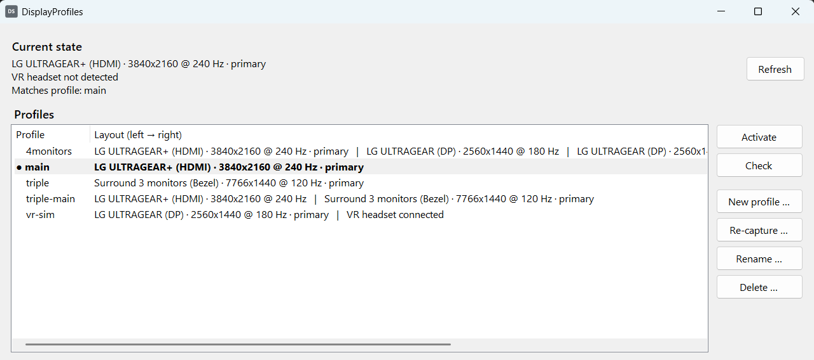

# DisplayProfiles

**Save and switch complete Windows display setups on NVIDIA GPUs — including NVIDIA Surround with
bezel correction — with one click from the tray. No reboot, no driver reload.**

> [!IMPORTANT]
> DisplayProfiles works with **NVIDIA graphics cards only**. It reads and sets the display
> configuration through NVIDIA's driver interface (NVAPI) and does not start on systems without an
> NVIDIA GPU and driver. AMD and Intel graphics are not supported.



## Why

A typical sim-racing rig has more than one way to use its screens: a triple-monitor NVIDIA Surround
for racing, a single desktop monitor for work, a VR headset for VR titles. Switching between them in
the NVIDIA Control Panel and the Windows display settings takes many clicks — and some combinations
do not work at all without a reboot.

DisplayProfiles started with exactly such a case: the VR headset shares a DisplayPort output with one of
the Surround monitors. As long as the Surround grid holds that output, the headset is not detected.
DisplayProfiles dissolves and rebuilds the Surround grid on demand through NVIDIA's NVAPI, so the
headset is detected via plug & play and the triple setup comes back afterwards — in seconds.

## Features

- **Capture the current setup as a profile** — active displays, positions, resolution, refresh rate,
  primary display, and the NVIDIA Surround grid including bezel-correction gaps.
- **One-click switching** from the tray menu or the companion window.
- **Surround on and off without a driver reload.** Every change is validated by the NVIDIA driver and
  by Windows before it is applied; anything that would need a driver reload is refused.
- **Safe by design** — checks that the right monitors (by serial number) are connected, writes a
  backup of the current state before each switch, and reads the result back to verify it.
- **Real refresh rates** — reads the rate the driver actually drives (the NVAPI Surround queries
  report a fixed default).
- **VR headset detection** via EDID, shown in the tray icon.
- **Local REST API** for integrations such as Stream Deck, SimFeedback or scripts.
- Tray app with companion window, start with Windows, single instance, installer.

## Requirements

- Windows 10 or 11, x64
- NVIDIA GPU with a current GeForce driver (Surround profiles need GeForce Surround)
- .NET 8 Desktop Runtime and ASP.NET Core 8 Runtime — the installer downloads them if missing

## Installation

Download `DisplayProfiles-<version>-setup.exe` from the Releases page and run it. The setup can
register DisplayProfiles to start with Windows. Profiles are stored per user in
`%LOCALAPPDATA%\DisplayProfiles\profiles` and are kept on uninstall.

## Usage

1. **Arrange your displays** the way you want them — in the Windows display settings and, for
   Surround, in the NVIDIA Control Panel (layout, bezel correction, resolution, refresh rate).
2. **Open the companion window** (double-click the tray icon) and choose **New profile …**. The
   dialog shows exactly what will be saved; give it a name and save.
3. **Switch** with a right-click on the tray icon and a click on the profile — or select it in the
   companion window and press **Activate**.

| Tray icon | Meaning |
|-----------|---------|
| grey | idle |
| blue | VR headset detected |
| orange | switch in progress (do not plug or unplug displays now) |

Profiles are snapshots. To change one, set up the displays by hand and use **Re-capture …**.
**Delete …** moves a profile to an archive folder; nothing is deleted for good.

A switch that changes Surround takes about 15–20 seconds and the screens go black briefly. Other
switches take a few seconds.

## Integration

The tray app hosts a REST API on `http://127.0.0.1:47811/` (localhost only):

```http
GET  /api/status                       current layout, headset, matching profiles
GET  /api/profiles                     all profiles
POST /api/profiles/{name}/apply        switch (add ?check=true to validate only)
```

Full reference: [docs/rest-api.md](docs/rest-api.md). A console tool (`DisplayProfiles.Cli.exe`) is
installed as well, for scripting and diagnostics.

## How it works

DisplayProfiles combines two APIs:

- **NVAPI Mosaic** (`NvAPI_Mosaic_*`) for the Surround grid — read, validate and set, always with the
  *no driver reload* flag.
- **Windows CCD** (`QueryDisplayConfig` / `SetDisplayConfig`) for the desktop layout, refresh rate
  and primary display.

A profile stores the raw Surround grid and the raw Windows path/mode data, which makes an exact
restore possible. Details, including the NVAPI quirks found on the way, are in
[docs/technical-notes.md](docs/technical-notes.md).

## Building from source

```powershell
dotnet build DisplayProfiles.slnx -c Release          # build
.\installer\build-installer.ps1                       # publish + installer -> Releases\<version>\
```

Requires the .NET 8 SDK. The installer script restores Inno Setup from NuGet; nothing has to be
installed system-wide. The version is taken from the `VERSION` file.

| Project | Output | Purpose |
|---------|--------|---------|
| `src/DisplayProfiles.Core` | `DisplayProfiles.Core.dll` | Display logic: NVAPI, Windows CCD, profiles, switching |
| `src/DisplayProfiles.Tray` | `DisplayProfiles.exe` | Tray app, companion window, REST API |
| `src/DisplayProfiles.Cli` | `DisplayProfiles.Cli.exe` | Console tool |

## Tested setup and limitations

Developed and tested on one rig: GeForce RTX 5090, a 4K monitor on HDMI, three 1440p monitors on
DisplayPort as a bezel-corrected Surround, and a Shiftall MeganeX superlight 8K VR headset sharing a
DisplayPort output with the left Surround monitor.

- NVIDIA GPUs only; Surround profiles need GeForce Surround.
- Headset detection currently recognises the MeganeX superlight 8K only (other displays and profiles
  work regardless).
- The NVIDIA Control Panel option *Confine Taskbar to Single Display* is not available through the
  public NVAPI and is not part of a profile.

DisplayProfiles changes your display configuration. It validates every step and never restarts the
driver, but it comes without warranty — see the license.

## License

Copyright (c) 2026 Rausch IT. Released under the MIT License — see [LICENSE](LICENSE).

You may use, modify and redistribute the code, also commercially, as long as the copyright notice
"Copyright (c) 2026 Rausch IT" and the license text are kept in all copies or substantial portions of
it. A mention of Rausch IT and a link back to this repository in derived projects is appreciated.

Third-party notices: [THIRD-PARTY-NOTICES.md](THIRD-PARTY-NOTICES.md).
NVIDIA, GeForce and Surround are trademarks of NVIDIA Corporation; this project is not affiliated with
NVIDIA.
